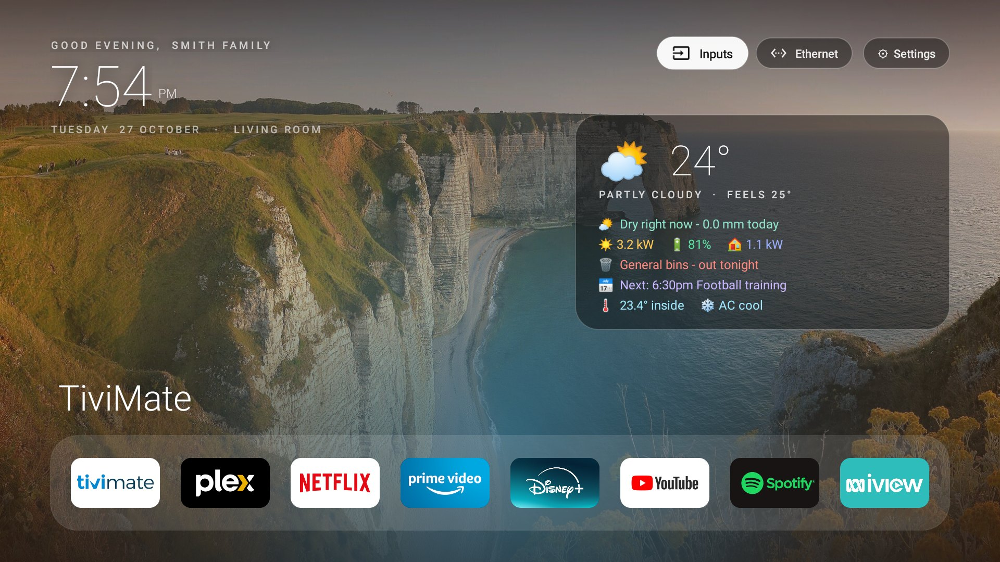
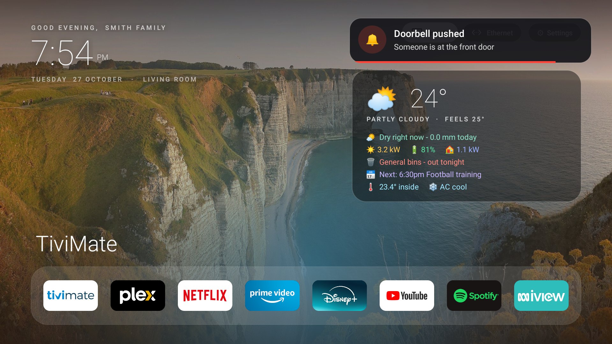
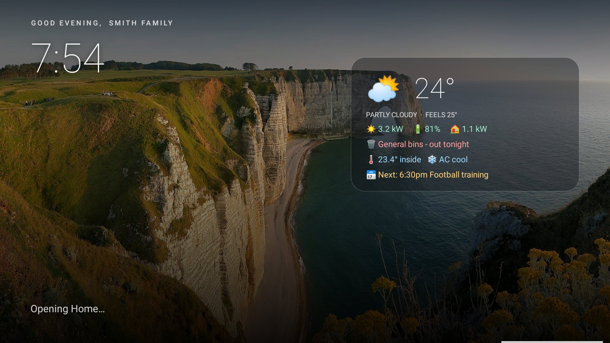
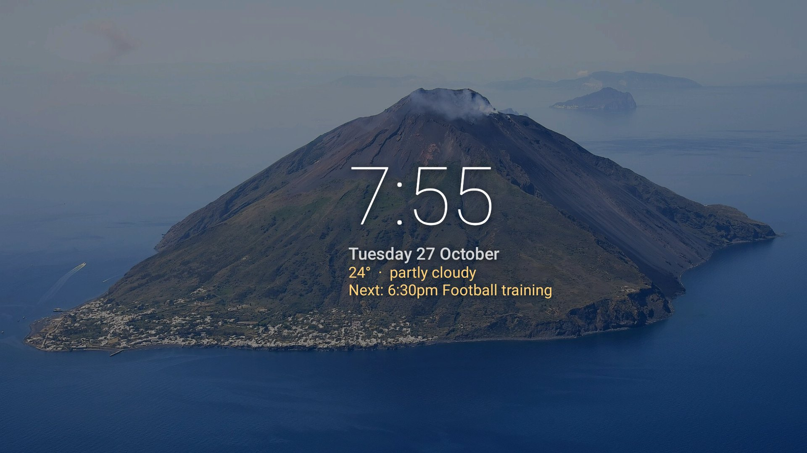

# Fire TV Debloat Launcher

A clean, fast, ad-free home screen for **Amazon Fire TV**, plus a reversible debloat script. No ads, no sponsored rows, no
account, no cloud. Works on its own; [Home Assistant](docs/HOME-ASSISTANT.md) is optional.



| Alert cards over any app | While Home is opening | Screensaver |
|---|---|---|
|  |  |  |

## Tested on
- **Fire TV Cube (3rd gen, AFTGAZL)**, Fire OS 7.7.1.7 (Android 9), wired through a USB Ethernet adapter
- **Fire TV Stick 4K Max (AFTKA)**, Fire OS 7.7.1.3 (Android 9)

Other Fire OS 7 devices will probably work. Not tested on Fire OS 8 / Vega OS devices.

## Features
- Apple TV style home: greeting, clock, slow-zoom wallpaper slideshow, main app row plus an apps list that puts recent apps first.
- **Home button takes you here.** Fire OS blocks other apps for a few seconds after Home is pressed, so a cover screen (greeting,
  clock, loading bar, optional house info) hides Amazon's home until the launcher opens.
- Hold OK on any app to move it, add it to the main row, hide it, open its info or uninstall it. No rebuild needed.
- Settings and Wi-Fi/Ethernet pills open Amazon's own full-screen pages; **Inputs** pill on devices with HDMI in (Cube).
- Screensaver (big clock over a drifting wallpaper) instead of Amazon's ad-supported one.
- Alert cards over whatever is playing: doorbell, bins, timers (`am broadcast`, or from Home Assistant).
- **Debloat script** (reversible): disables Amazon shopping, ad-ID and content-recognition packages, limits ad tracking, speeds up animations.
- Optional Home Assistant link: weather / solar / battery / bins panel, Plex "keep watching" cards, sleep timer, doorbell card.
  Plus [prompts for Claude, Codex or any AI agent](docs/AI-PROMPTS.md) that do the setup for you.

## Quick start
1. On the TV: Settings > My Fire TV > About, press OK on the device name 7 times, then Developer Options > turn on **ADB debugging**.
2. Install `adb` on your PC, download `tvhome.apk` from the [latest release](../../releases/latest).
3. ```
   tools/firetv-install.sh <tv-ip> tvhome.apk      # accept the on-TV debugging prompt the first time
   tools/firetv-tune.sh <tv-ip>                    # optional: ad/bloat clean-up and speed-ups
   ```
4. Press Home on the remote. Undo everything any time with `tools/firetv-undo.sh <tv-ip>`.

Full guide, settings (name, family name, app order, wallpapers) and Fire OS notes: [FIRETV.md](FIRETV.md).
Ad hosts to block in Pi-hole / AdGuard: [docs/DEBLOAT.md](docs/DEBLOAT.md).

## Limits (the honest list)
- Amazon's own home screen **cannot be removed** (it is a protected package); this puts a launcher in front of it and hides the ads.
  Banners on Amazon's screen come from Amazon's servers, so block those hosts at the network if you want them gone entirely.
- The remote's Home press reaches Amazon first, so there is a short cover screen (about 4 seconds) before the launcher appears.
- Netflix does not share watch history, so "keep watching" cards come from Plex only (a manual Netflix card is possible).
- The mic button is handled by Amazon and still works; there is no voice button in the launcher.
- This is an unofficial project, not affiliated with or endorsed by Amazon. You use it at your own risk; everything is reversible.

## Credits and licence
MIT. Forked from [mihirgupta0900/tv-home](https://github.com/mihirgupta0900/tv-home) (Android TV launcher, original README in
[docs/UPSTREAM-README.md](docs/UPSTREAM-README.md)). Fire TV port, Home-key service, cover screen, alerts, screensaver, debloat tools and
Home Assistant integration added here. App tiles use each app's own banner from your device. Wallpapers: see
[`launcher/WALLPAPER-CREDITS.md`](launcher/WALLPAPER-CREDITS.md) (Wikimedia Commons CC BY-SA, NASA public domain).
